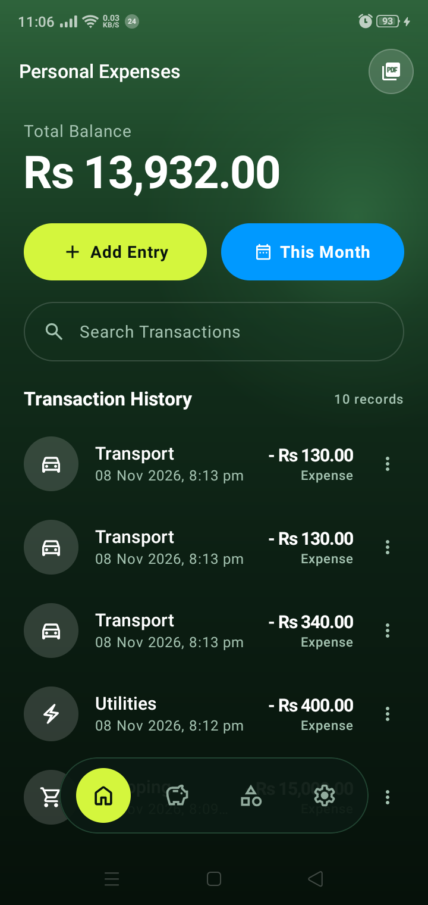
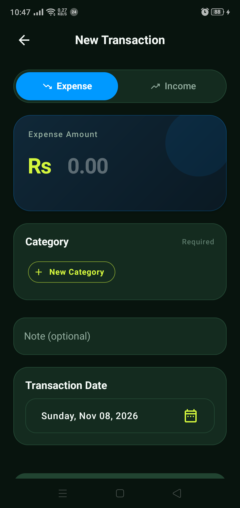
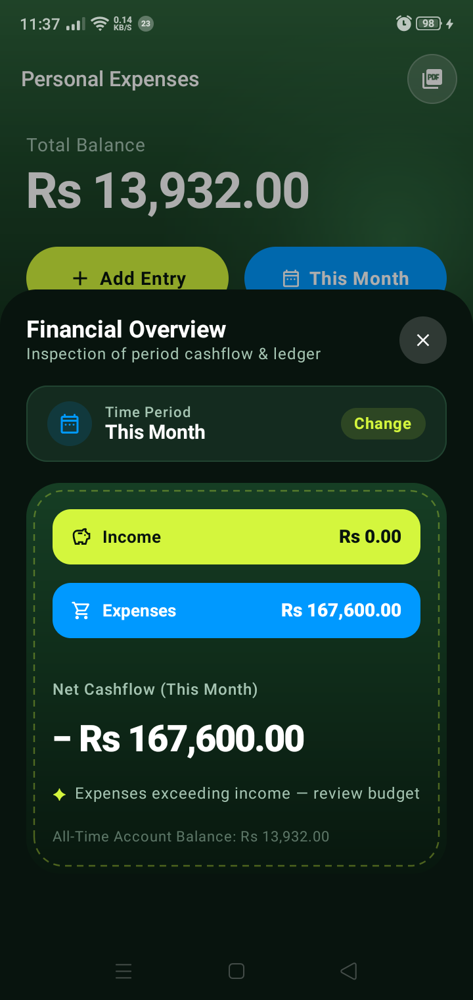
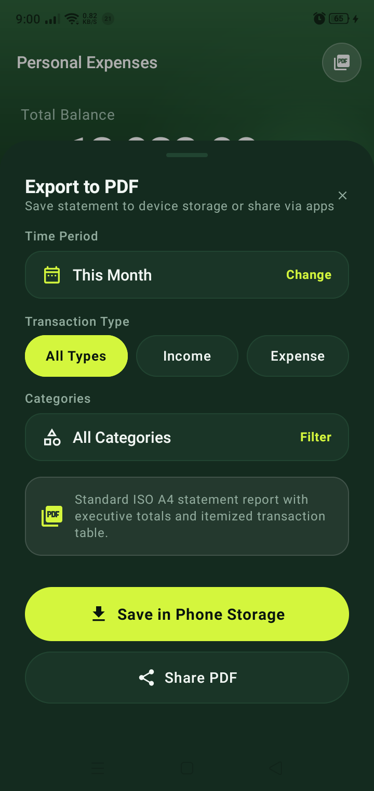
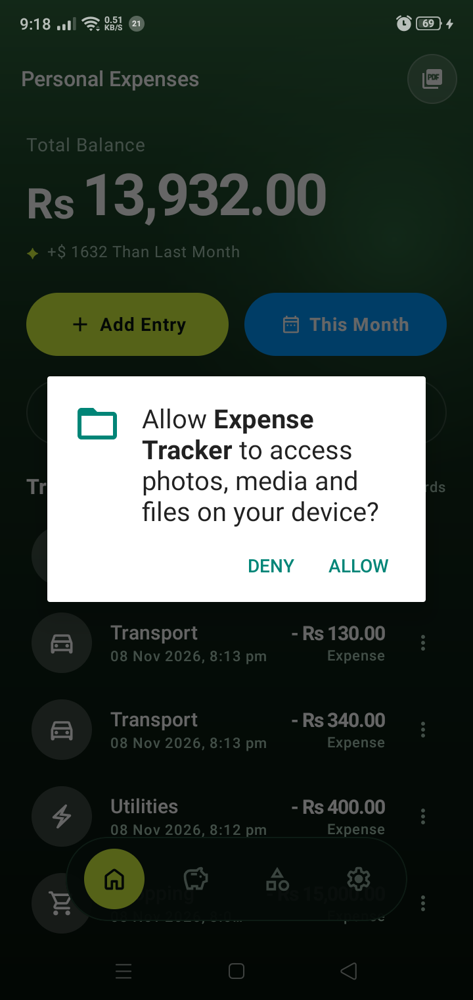
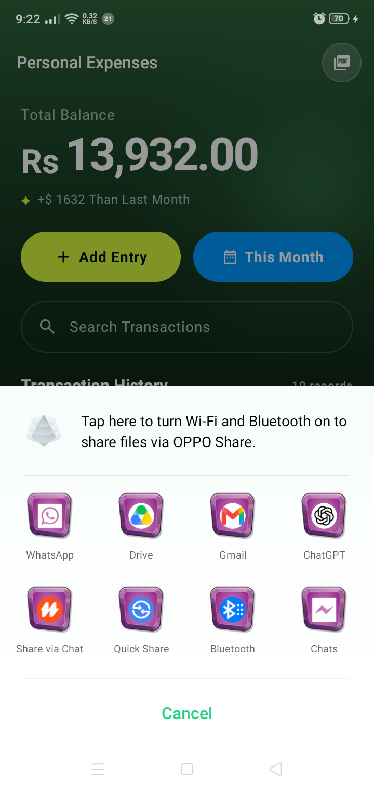

# Expense Tracker

A production-grade, offline-first personal finance Android application built with modern Android development practices, Clean Architecture, and an Organic Forest Luxury design system.

---

## Screenshots

| Personal Expenses Dashboard | Add Entry (Calm Theme) | Financial Overview |
| :---: | :---: | :---: |
|  |  |  |

| PDF Statement Export | Proactive Permission Verification | System Share Sheet |
| :---: | :---: | :---: |
|  |  |  |

| Native Branded Splash | Adaptive Launcher Icon | Round Launcher Icon |
| :---: | :---: | :---: |
|  |  |  |

---

## Features

### Core Capabilities
- **Offline First** — fully functional without internet, always. Room SQLite database is the local single source of truth.
- **Transaction Management** — add, edit, and soft-delete income and expense transactions, with atomic balance recalculation on every operation.
- **Smart Balance Tracking** — real-time running balance with O(1) reads, maintained directly on the ledger entity rather than recalculated by scanning historical rows.
- **Category System** — transactions organized by categories with Material Symbol icons, seeded automatically on first launch with fixed, idempotent IDs, plus user custom category creation.
- **Search & Multi-Category Filtering** — live debounced search query flow and bottom sheet multi-category filters with active badge counters.
- **Strategy-Driven Date Filtering** — period filtering (`AllTime`, `Today`, `ThisWeek`, `ThisMonth`, `ThisYear`, `Custom`) implemented via the Strategy Pattern for zero-coupling extensibility, allowing complete historical inspection across all time (`0L to Long.MAX_VALUE`).
- **Currency Support** — default currency detected from the device's SIM country (falling back to locale), searchable currency picker supporting 150+ currencies with natural colloquial symbols (`Rs` for PKR, `$` for USD, `₹` for INR, `€` for EUR, `£` for GBP, etc.).
- **Live Theme Switching** — dynamic System, Light, or Dark modes with edge-to-edge system bar synchronization.
- **Branded App Startup** — official AndroidX `SplashScreen` API integrated before `super.onCreate()`, handing off to an organic branded Compose overlay gated on first-launch database seeding.
- **Receipt-Style Transaction Detail** — tap any transaction for a modal breakdown, status badge, and one-tap edit routing.
- **Export to PDF Statements** — generate professional, hardware-accelerated ISO A4 PDF statements with executive summary cards (inflow, outflow, net balance) and itemized ledger tables; automatically inherits dashboard filters and supports live in-modal customization with two dedicated export flows:
  - **Save in Phone / SD Storage**: Proactively verifies storage permissions (with `WRITE_EXTERNAL_STORAGE` on API $\le 28$ and Scoped Storage `MediaStore` on Android 10+), automatically detects preferred storage (Phone Storage or external SD Card), and writes directly to `Download/ExpenseTracker/` with an interactive "Open" snackbar and SAF fallback.
  - **Share PDF**: Seamlessly shares the generated statement via Android's secure `FileProvider` and system chooser.
- **Contextual Material 3 Tooltips** — accessible, dark-forest-styled tooltips (`AppTooltip`) across interactive icon buttons and actions (PDF Export, Home, Ledger, Categories, Settings, Add Entry, Period Filter, Clear Search, Back Navigation, and Transaction Menus) triggerable via long-press on touch screens and hover on pointers.
- **Structured Error Handling** — sealed `UiError` hierarchy and `AppResult<T>` wrapper around all repository operations.

---

## Design Language: Organic Forest Luxury

The app features a bespoke **Organic Forest Luxury** fintech aesthetic inspired by modern wealth management interfaces (e.g. Wise, Monzo, Apple Card):

- **Base Canvas**: Radiant moss-to-obsidian vertical canopy gradient (`#2E633B` $\to$ `#122E1B` $\to$ `#06110A`) with an organic ambient top-right radial light source matching the mockup aesthetic.
- **Hero Balance**: Large, uncluttered bold balance typography (`Rs 156,532.00`) floating directly on the radiant green canopy with unified optical scale, zero clutter, and direct visual hierarchy flowing straight into the action pills.
- **High-Energy Action Pills**: Thumb-friendly quick actions row right below the hero balance: symmetrical 50/50 split with **Neon Lime** `+ Add Entry` pill and **Sky Blue** `This Month` period filter, providing balanced ergonomic reach without redundant actions.
- **Embedded Search Pill**: Floating translucent search capsule (`🔍 Search Transactions`) directly embedded on the dashboard for instant, debounced real-time filtering.
- **Floating Pill Bottom Navigation**: Floating dark glass navigation capsule (`#0B1A12` with 32dp corner radius) docked at the bottom with 4 circular glass icons (Home, Ledger, Categories, Settings) that float gracefully above scrolling content, serving as the single source of truth for global navigation.
- **Total Cards & Stitched Leathercraft Modal**: Tapping the Ledger icon (`🏛`) in the floating bottom bar opens the Screen 2 inspection sheet featuring the handcrafted stitched leathercraft card with dual yellow Savings and blue Spend account pills.
- **Streamlined Non-Redundant Navigation**: Each action has exactly one clear, dedicated home — Settings is accessed exclusively via the floating bar's profile tab, Categories filter via the bottom bar tag, and Total Cards via the ledger icon, eliminating duplicate triggers and back-button ambiguity.
- **Directional Cashflow**: Emerald Green (`#10B981`) with `+` sign for Inflow/Deposits; Crimson Rose (`#F43F5E`) with `−` sign for Outflow/Expenses.
- **Humanized Micro-Copy**: Dynamic balance health indicators (*"✦ Healthy financial balance maintained"*), status badges (*"✦ Live Ledger"*), and conversational relative timestamps (*"Today, 2:30 PM • Food"*).
- **Full Compose Preview Coverage**: 100% of standalone presentation components include light and dark `@Preview` annotations for instant design inspection in Android Studio.

---

## Architecture & Design Patterns

This project adheres strictly to **Clean Architecture** with **MVVM** and modern object-oriented / functional design patterns:

```
app/
├── data/
│   ├── local/                  # Room database, DAOs, entities, seeders
│   │   ├── dao/                # Data Access Objects (TransactionDao, LedgerDao, etc.)
│   │   ├── database/           # AppDatabase, SQLite migrations
│   │   └── entity/             # Room entities (Transaction, Category, Ledger, MonthlySnapshot)
│   └── repository/             # Repository interfaces + Hilt @Singleton implementations
│
├── domain/
│   ├── model/                  # Domain models, sealed classes, Strategy filters, Sync contracts
│   │   └── sync/               # SyncableEntity and SyncStatus contracts for v0.3 roadmap
│   └── usecase/                # Business logic use cases (PdfReportGenerator, etc.)
│
├── presentation/
│   ├── common/                 # BaseViewModel with CoroutineExceptionHandler
│   ├── dashboard/              # Dashboard screen, BalanceCard, SummaryCard, ViewModel
│   ├── transaction/            # Add/Edit form, TypeToggle, AmountInput, CategoryPicker
│   ├── settings/               # Settings screen, ThemeModeSelector, CurrencyPickerDialog
│   └── navigation/             # NavGraph, Screen sealed data objects
│
└── di/                         # Hilt dependency injection modules (DatabaseModule, RepositoryModule)
```

### Applied Design Patterns

- **Strategy Pattern (`DateRangeFilter`)**:
  Date period boundaries (`AllTime`, `Today`, `ThisWeek`, `ThisMonth`, `ThisYear`, `Custom`) are encapsulated inside `DateRangeFilter.calculateRange(now)`. The `DashboardViewModel` simply invokes `selectedFilter.calculateRange()`, satisfying the **Open/Closed Principle (OCP)** — new reporting periods can be added without modifying ViewModel or UI code.
- **Factory Method Pattern (`Transaction`, `Category`, `Ledger`)**:
  Entity companion objects provide `.create(...)` factory methods that handle UUID generation, timestamp synchronization (`createdAt`, `updatedAt`), and invariant defaults. A `.toSoftDeleted()` transition method handles soft-deletion state cleanly.
- **Singleton Pattern (Hilt Dependency Injection)**:
  `AppDatabase`, `UserPreferences`, and all repository bindings are scoped as `@Singleton`, ensuring memory efficiency and centralized coordination.
- **Roadmap Sync Contracts (`SyncableEntity`)**:
  `Transaction` and `Ledger` implement `SyncableEntity` (`id`, `updatedAt`), laying the architectural foundation for v0.3 offline-first cloud sync with Last-Write-Wins (LWW) conflict resolution.
- **Modern Edge-to-Edge Architecture**:
  Utilizes Android 15 standard `enableEdgeToEdge()` on `ComponentActivity` paired with dynamic `DisposableEffect` system bar updating for seamless status and navigation bar blending.

---

## Tech Stack

| Layer | Technology |
|---|---|
| Language | Kotlin 2.4.21 |
| UI Toolkit | Jetpack Compose + Material 3 (BOM 2026.09.00) |
| Architecture | Clean Architecture + MVVM + Strategy/Factory Patterns |
| Navigation | Navigation Compose 2.10.2 |
| Database | Room 2.8.5 with KSP |
| Dependency Injection | Hilt 2.60.1 |
| Asynchronous | Kotlin Coroutines 1.11.0 + StateFlow |
| Local Preferences | Jetpack DataStore Preferences 1.2.1 |
| Startup | AndroidX SplashScreen 1.2.0 + Edge-to-Edge Activity 1.13.0 |
| Testing | JUnit4, MockK, Turbine, AndroidX Test Runner |
| Build System | Gradle 9.4 with Version Catalogs (`libs.versions.toml`) |

---

## Database Schema

### Entities

**`transactions`**
```
id              TEXT    PRIMARY KEY     (UUID, device-generated)
ledgerId        TEXT    FOREIGN KEY     → ledgers(id) CASCADE
categoryId      TEXT    FOREIGN KEY     → categories(id) SET NULL
amount          REAL
type            TEXT                    INCOME | EXPENSE
note            TEXT
date            INTEGER                 epoch milliseconds
createdAt       INTEGER
updatedAt       INTEGER
isDeleted       INTEGER                 soft delete flag (0 = active, 1 = deleted)
```

**`ledgers`**
```
id              TEXT    PRIMARY KEY     (UUID or "ledger_default")
name            TEXT
currencyCode    TEXT
balance         REAL                    running balance — O(1) read
totalIncome     REAL                    running total income
totalExpenses   REAL                    running total expense
createdAt       INTEGER
updatedAt       INTEGER
isDefault       INTEGER
```

**`categories`**
```
id              TEXT    PRIMARY KEY     (fixed on seed, e.g. "cat_food"; UUID for user-created)
name            TEXT
icon            TEXT                    Material Symbol identifier
transactionType TEXT                    INCOME | EXPENSE | BOTH
isDefault       INTEGER                 true for seeded categories, false for user-created
```

**`monthly_snapshots`**
```
id              TEXT    PRIMARY KEY     (UUID)
ledgerId        TEXT    FOREIGN KEY     → ledgers(id) CASCADE
month           INTEGER
year            INTEGER
openingBalance  REAL
closingBalance  REAL
totalIncome     REAL
totalExpense    REAL
createdAt       INTEGER
updatedAt       INTEGER

UNIQUE INDEX    (ledgerId, month, year)
```

---

## Testing & Verification

Unit test suite (`src/test`):
- `DateRangeFilterTest` — verifies Strategy pattern implementations and period boundary correctness.
- `CurrencyHelperTest` — tests colloquial local currency symbol resolution across global currency codes.
- `PdfStorageHelperTest` — tests storage path resolution and storage property contract for phone vs SD card targets.
- `DashboardViewModelTest` — tests search debounce, filter state changes, and soft-delete propagation.
- `SettingsViewModelTest` — tests live theme and currency preference persistence.
- `DateUtilsTest` — validates UTC-to-local midnight conversions and period boundaries.

Instrumentation test suite (`src/androidTest`):
- `LedgerDaoTest` — in-memory Room SQLite balance arithmetic and default ledger guard.
- `TransactionDaoTest` — atomic balance recalculation on insert, update, type switch, and soft delete.
- `TransactionRepositoryTest` — repository transaction integrity and foreign key cascading.

All test suites execute cleanly via:
```bash
# Unit tests
./gradlew testDebugUnitTest

# Assemble Debug APK
./gradlew assembleDebug
```

---

## CI/CD & Code Scanning

The repository uses GitHub Actions for automated continuous integration and static application security testing (SAST):

- **Android CI (`.github/workflows/android-ci.yml`)**: Checks out the code, configures Temurin JDK 17 with Gradle caching, runs `lint`, compiles the debug APK via `assembleDebug`, and uploads build artifacts.
- **CodeQL Security Analysis (`.github/workflows/codeql.yml`)**: Advanced CodeQL security scanning for Java & Kotlin with `build-mode: manual`. Explicitly compiles the Android project with `./gradlew assembleDebug --no-daemon` using JDK 17, providing full bytecode tracing and vulnerability detection across the codebase.
